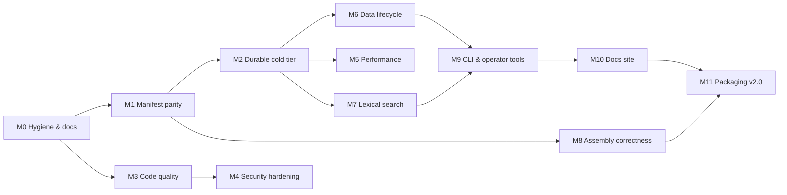

# Roadmap

This is the public to-do list for `memory-context`, the context-management plugin for
[OpenClaw](https://github.com/openclaw). It covers the work planned after **v1.5.0**
(released 2026-03-14). Each unchecked item will be tracked as a GitHub issue under the milestone
named in its section.

_Last updated: 2026-11-06_

---

## Where things stand (v1.5.0 baseline)

| Area | Status |
| :--- | :--- |
| Build (`npm run build`) | ✅ Compiles cleanly with TypeScript 5 |
| Tests | ✅ 17 suites, 71 tests passing |
| Line coverage | 69.8% overall. Gaps: `sqlite-persistence.ts` 0%, `multi-model.ts` 0%, `security.ts` 51%, `metrics.ts` 57% |
| CI | GitHub Actions on Node 20/22, Ubuntu only. `npm test` fails on Windows |
| Manifest vs. code | `openclaw.plugin.json` declares 15 tools, 10 gateway methods and 4 services. Only 2 tools are wired up in `src/` |
| Config vs. code | `enableContextDiff` and `autoDetectModel` are never read. `hierarchyLevels` (3–10) is accepted but the hierarchy is fixed at L0–L4. `retentionPolicy` is accepted but only `bounded` behaves differently |
| Cold tier (L2) | The README calls it an "archive", but it's an in-memory `Map`. It doesn't survive a restart and isn't compressed |
| Search | BM25 with a simplified stemmer, ASCII-oriented tokenization, no query syntax or filters. The index is rebuilt rather than persisted |
| Security helpers | `security.ts` uses regex blocklists; two bypasses were already found and patched (#33, #34) |
| Docs | README has version drift (v1.4.0 vs v1.5.0), says the repo is "private", and its tools/config tables don't match the manifest |
| Releases | Version bumps in `package.json`, but no git tags or GitHub Releases |

**Estimated total remaining work: about 160 hours**, split across 12 milestones.

---

## Scope

**In scope:** storage, persistence, lexical search (BM25), context assembly, the plugin API surface,
data lifecycle, a local CLI, security hardening of the plugin's own code, tests, docs, packaging
and developer tooling.

**Out of scope for this project:**

- Training, fine-tuning, evaluating or benchmarking AI models. Performance benchmarks here only
  measure this library's own code paths (storage, indexing, assembly) on synthetic text, with no
  model calls.
- Embedding models, vector databases or running model inference. Relevance stays lexical and
  heuristic.
- Hosted or multi-user services. The plugin runs locally inside the user's own OpenClaw instance.
- Real conversation or personal data in the repo. Fixtures and benchmarks use generated sample
  text only.

---

## Milestone order

---

## Milestone 0: Repository hygiene & docs (`v1.5.1`, about 8 h)

The goal is a README and repo where a newcomer can install and run the plugin in under five minutes.

- [ ] **Rewrite the README intro**: what the plugin does, who it's for (OpenClaw users running
      long sessions who want deterministic context rebuilds instead of lossy compaction), what it's
      built with (TypeScript, sql.js, gpt-tokenizer, Zod, lru-cache) and requirements (Node ≥ 20). _(1.5 h)_
- [ ] **Add a "Quick start" section**: clone, `npm ci`, `npm run build`, register the plugin in
      the OpenClaw config, verify with `memory_context_stats`. _(1 h)_
- [ ] **Fix doc drift**: remove "(private)", update the "Summary" section from v1.4.0 to the current
      version, regenerate the tools table and config table from `openclaw.plugin.json` (e.g. README
      uses `zeroShiftEnabled`, manifest uses `enableShiftImmunity`). _(1 h)_
- [ ] **Archive `IMPROVEMENTS.md`**: it's the original Feb 2026 analysis, mostly done and partly
      duplicated after line 366. Move it to `docs/history/2026-02-improvement-analysis.md` and link
      this roadmap instead. _(0.5 h)_
- [ ] **Add `CHANGELOG.md`** (Keep a Changelog format) and move the changelog out of the README. _(0.5 h)_
- [ ] **Add `CONTRIBUTING.md` and `SECURITY.md`**: dev setup, test commands, how to report a
      vulnerability. _(1 h)_
- [ ] **Make npm scripts cross-platform**: `npm test` currently runs
      `node node_modules/.bin/jest`, which fails on Windows because `.bin/jest` is a POSIX shell
      shim. Switch to `node_modules/jest/bin/jest.js`. _(0.5 h)_
- [ ] **Add `windows-latest` and `macos-latest` to the CI matrix.** _(0.5 h)_
- [ ] **Quiet test output**: silence `StructuredLogger` under `NODE_ENV=test` so CI logs show
      results, not hundreds of JSON warnings. _(0.5 h)_
- [ ] **Tag and publish GitHub Releases** for `v1.5.0` (retroactively) and `v1.5.1`, using the
      existing `release.yml` workflow. _(1 h)_

## Milestone 1: Manifest parity & host integration (`v1.6.0`, about 18 h)

The goal is that everything `openclaw.plugin.json` advertises actually exists, works, and is tested
against a realistic host.

- [ ] **Audit the manifest**: for each of the 15 tools, 10 gateway methods and 4 services, decide
      whether to implement or remove it. Record the decisions in `docs/api.md`. _(1 h)_
- [ ] **Implement core tools** backed by existing engine methods: `memory_context_stats`,
      `memory_context_anchor`, `memory_context_history`, `memory_context_recall`,
      `memory_context_snapshot`, `memory_context_restore`. _(5 h)_
- [ ] **Implement JIT/shift tools**: `memory_context_jit_build`, `memory_context_jit_clear`,
      `memory_context_shift_check`, `memory_context_validate`. _(3 h)_
- [ ] **Implement `memory_context_diff`** (driven by the currently unused `enableContextDiff`
      setting): a structured diff of included/excluded entries between two builds. _(2 h)_
- [ ] **Remove or implement the remaining items** (`memory_context_profile`,
      `memory_context_optimize`, the 4 `services`). No dead entries should be left. _(1 h)_
- [ ] **Wire up the unused config keys**: `autoDetectModel`, `enableContextDiff`. Validate the
      whole plugin config with a Zod schema generated from the manifest's `configSchema`. _(1.5 h)_
- [ ] **Add one integration test per tool/gateway method** using a synthetic conversation fixture. _(1.5 h)_
- [ ] **Build a mock OpenClaw host harness** under `tests/harness/`: load the plugin through
      `activate()`, deliver lifecycle events (load, message, model switch, unload) and call tools
      the way the host does. Use it in all integration tests. _(3 h)_

## Milestone 2: Durable cold tier & persistence (`v1.7.0`, about 14 h)

The goal is that L2 works as the README describes: persistent, compressed, crash-safe and recoverable.

- [ ] **Persist L2 to disk**: replace the in-memory `l2Archive` map with a SQLite table (or a
      compressed append-only file) through `SQLitePersistence`. _(3 h)_
- [ ] **Use the existing `CompressionManager`** (gzip/brotli, `src/utils/compression.ts`) for L2
      payloads, honoring `l2Compress`. _(1 h)_
- [ ] **Reload L0/L1/L2 state at startup** and rebuild the BM25 index from persisted rows. _(2 h)_
- [ ] **Add versioned schema migrations** (`schema_version` table, forward-only migrations). _(1 h)_
- [ ] **Test `SQLitePersistence`** (currently 0% coverage): save/load round-trip, auto-save,
      backup and recovery from a corrupted DB file. Target ≥ 80%. _(3 h)_
- [ ] **Make writes atomic**: sql.js exports the whole DB, so write to a temp file, fsync, then
      rename. Interrupted saves must never leave a truncated database. _(1.5 h)_
- [ ] **Add a single-writer lock file** so two OpenClaw processes pointed at the same data
      directory can't corrupt each other's database. Fail with a clear error instead. _(1.5 h)_
- [ ] **Add database maintenance**: periodic `VACUUM`/`ANALYZE` and reporting of file size vs.
      live data in `memory_context_stats`. _(1 h)_

## Milestone 3: Code quality & type safety (continuous, about 12 h)

- [ ] **Remove the 41 remaining `any` usages** in `src/`. Type the OpenClaw message and context
      objects properly. _(3 h)_
- [ ] **Add ESLint (typescript-eslint) and Prettier** with a `lint` script and a CI step. _(1.5 h)_
- [ ] **Raise test coverage**: `multi-model.ts` (0%), `security.ts` (51%), `metrics.ts` (57%),
      `validation/schemas.ts` functions (24%). _(4 h)_
- [ ] **Enforce a coverage threshold** (`coverageThreshold` ≥ 80% lines) in `jest.config.js`. _(0.5 h)_
- [ ] **Move model context-window profiles to a data file** that users can override from config.
      Drop the hard-coded pricing fields, which go stale and aren't used for context sizing. _(1 h)_
- [ ] **Turn on stricter compiler flags**: `noUncheckedIndexedAccess`,
      `exactOptionalPropertyTypes`, `noImplicitOverride`. Fix the fallout. _(2 h)_

## Milestone 4: Security hardening (`v1.7.x`, about 12 h)

This is defensive hardening of the plugin's own input handling and storage.

- [ ] **Rewrite the sanitizers in `security.ts`**: normalize first (Unicode NFC, URL-decode,
      path resolve), then check against an allowlist. The current regex blocklists already had two
      bypasses (#33, #34). _(3 h)_
- [ ] **Add property-based tests** (fast-check) for the sanitizers and path checks: random and
      encoded inputs must never escape the data directory or skip sanitization. _(2 h)_
- [ ] **Audit every SQL statement** to confirm it's parameterized. Add a test that fails if
      string-built SQL appears in `src/persistence`. _(1 h)_
- [ ] **Lock down the data directory**: create DB and backup files with `0600` permissions, and
      make the data directory configurable with a safe default under the OpenClaw state dir. _(1 h)_
- [ ] **Add optional encryption at rest**: AES-256-GCM via `node:crypto`, with the key derived
      (scrypt) from a passphrase in an environment variable. Off by default and documented, with a
      `.env.example` placeholder. _(3 h)_
- [ ] **Add CodeQL, Dependabot and `npm audit`** to CI. _(1 h)_
- [ ] **Generate an SBOM** (CycloneDX) and attach it to each GitHub Release. _(1 h)_

## Milestone 5: Performance & reliability (about 10 h)

All measurements run on generated synthetic text. No model is called.

- [ ] **Make `benchmarks/run-benchmarks.ts` reproducible**: fixed seeds, synthetic corpora of
      1k/10k/100k messages, JSON output committed under `benchmarks/results/`. _(2 h)_
- [ ] **Verify or correct the README's performance claims** ("JIT rebuild < 50 ms",
      "~1000 ops/sec", "L1 access < 10 ms") with the benchmark numbers. _(1 h)_
- [ ] **Add concurrency stress tests**: many parallel `onMessage` + `buildContext` calls with no
      lost or duplicated entries and no token-count drift across tiers. _(2 h)_
- [ ] **Add a memory-ceiling test**: a long synthetic session must stay within configured tier
      limits. _(1.5 h)_
- [ ] **Run benchmarks in CI** (manual `workflow_dispatch`) and fail on a > 20% regression. _(1.5 h)_
- [ ] **Profile and fix the top hotspots** the benchmarks reveal (likely candidates: full
      re-scoring on every build and JSON re-serialization on tier moves). _(2 h)_

## Milestone 6: Retention & data lifecycle (`v1.8.0`, about 18 h)

The goal is that users control what's kept, for how long, and can export or delete it.

- [ ] **Implement all three `retentionPolicy` modes** (`infinite`, `bounded`, `circular`) with
      clearly documented behavior and tests for each. _(3 h)_
- [ ] **Add TTL/age-based expiry per tier**, configurable and applied during maintenance. _(2 h)_
- [ ] **Add session namespaces** so multiple OpenClaw sessions or agents can share one database
      without seeing each other's history. Scope storage, index and anchors by namespace. _(4 h)_
- [ ] **Add a "forget" API and tool**: delete by message id, session or time range across
      L0/L1/L2, the BM25 index and anchors, and verify that nothing is left behind. _(3 h)_
- [ ] **Add NDJSON export/import** with a versioned schema, for backups and machine moves. _(3 h)_
- [ ] **Add a backup rotation policy** (keep the last N backups, configurable). _(1 h)_
- [ ] **Write a data-handling doc page**: what's stored, where, in what format, and how to export
      or delete it. _(2 h)_

## Milestone 7: Lexical search improvements (`v1.9.0`, about 18 h)

The goal is better recall and precision while staying fully lexical (no embeddings).

- [ ] **Replace the simplified stemmer** with a full Porter2 (Snowball English) implementation
      and test it against the reference word list. _(3 h)_
- [ ] **Use Unicode-aware tokenization** via `Intl.Segmenter`, including CJK segmentation and
      optional diacritic folding. _(3 h)_
- [ ] **Add field-weighted BM25F** over content, role, anchor type and tags. _(3 h)_
- [ ] **Add query syntax**: quoted phrases, `-exclusions`, and filters such as `role:`, `tier:`,
      `since:` and `session:`. _(3 h)_
- [ ] **Persist the index incrementally** instead of rebuilding it from all rows at startup. _(2 h)_
- [ ] **Add snippets and term highlighting** to search results and `memory_context_search`
      output. _(1.5 h)_
- [ ] **Add opt-in typo tolerance** with a trigram index. _(2.5 h)_

## Milestone 8: Assembly correctness & hierarchy (`v1.10.0`, about 16 h)

The goal is that context assembly is provably within budget, deterministic and explainable.

- [ ] **Add per-layer token quotas** in `HierarchicalContext`, and honor `hierarchyLevels` (3–10)
      instead of the fixed L0–L4. _(4 h)_
- [ ] **Add property-based tests** for assembly: the budget is never exceeded, required anchors
      are always included, and the same inputs always produce the same output. _(3 h)_
- [ ] **Add golden-file tests** for assembled context on synthetic conversations, so any change
      to the output is visible in review. _(2 h)_
- [ ] **Add an anchor lifecycle**: superseding and expiring decision anchors, and detecting
      conflicting state anchors. _(3 h)_
- [ ] **Add an "explain build" mode**: a per-entry score breakdown and the reason each entry was
      included or excluded. _(2 h)_
- [ ] **Bound predictive assembly**: cap its cache memory, invalidate on new messages, and keep
      it off by default until benchmarks show a benefit. _(2 h)_

## Milestone 9: CLI & operator tooling (`v1.11.0`, about 14 h)

- [ ] **Add a `memory-context` CLI** (package `bin`) with `stats`, `search` and `inspect`
      commands that work on a data directory without OpenClaw running. _(4 h)_
- [ ] **Add `export`, `import` and `forget` subcommands** that reuse the Milestone 6 APIs. _(2 h)_
- [ ] **Add a `doctor` command**: DB integrity (`PRAGMA integrity_check`), schema version,
      config validity, file permissions and lock state. _(2.5 h)_
- [ ] **Add an optional local `/metrics` endpoint** for Prometheus, bound to `127.0.0.1` and off by
      default. _(2 h)_
- [ ] **Make the log level configurable** and redact message content from logs by default. _(1.5 h)_
- [ ] **Wire the health checks into the `memory_context.status` gateway method.** _(2 h)_

## Milestone 10: Docs site & community (about 10 h)

- [ ] **Publish a docs site** (VitePress on GitHub Pages): architecture, configuration, tools,
      CLI and data handling. _(3 h)_
- [ ] **Generate the configuration reference from the manifest schema**, with a CI check that
      fails when the docs drift. _(2 h)_
- [ ] **Write architecture decision records** for no-compaction, sql.js over native SQLite, the
      tier design, and staying lexical-only. _(2 h)_
- [ ] **Add issue/PR templates, `CODEOWNERS` and a code of conduct.** _(1 h)_
- [ ] **Write a tutorial**: setting up memory-context for a long-running OpenClaw session, from
      install to search to export. _(2 h)_

## Milestone 11: Packaging & developer experience (`v2.0.0`, about 10 h)

- [ ] **Replace the `lazyRequire` Proxy** in root `index.ts` with normal ESM exports. Ship a dual
      ESM/CJS build. _(3 h)_
- [ ] **Generate API reference docs with TypeDoc** and publish them alongside the docs site. _(2 h)_
- [ ] **Add an `examples/` folder**: a minimal OpenClaw config plus a standalone Node script using
      `createMemoryContext()`. _(2 h)_
- [ ] **Publish to npm** (remove `"private": true`) and/or submit to the OpenClaw plugin
      registry. _(2 h)_
- [ ] **Write a migration guide from 1.x to 2.0** for removed manifest entries and changed exports. _(1 h)_

---

## Effort summary

| Milestone | Target version | Estimate |
| :--- | :--- | ---: |
| 0. Repository hygiene & docs | v1.5.1 | ~8 h |
| 1. Manifest parity & host integration | v1.6.0 | ~18 h |
| 2. Durable cold tier & persistence | v1.7.0 | ~14 h |
| 3. Code quality & type safety | continuous | ~12 h |
| 4. Security hardening | v1.7.x | ~12 h |
| 5. Performance & reliability | — | ~10 h |
| 6. Retention & data lifecycle | v1.8.0 | ~18 h |
| 7. Lexical search improvements | v1.9.0 | ~18 h |
| 8. Assembly correctness & hierarchy | v1.10.0 | ~16 h |
| 9. CLI & operator tooling | v1.11.0 | ~14 h |
| 10. Docs site & community | — | ~10 h |
| 11. Packaging & developer experience | v2.0.0 | ~10 h |
| **Total** | | **~160 h** |

## How to help

Pick any unchecked item, open (or comment on) the matching issue, and send a PR against `main`.
Run `npm run ci` locally before opening it.
